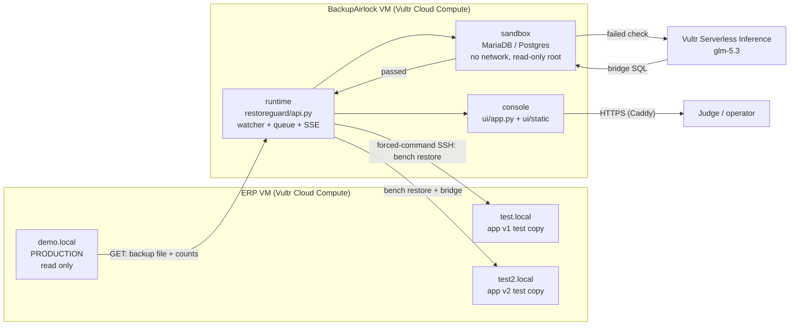

# BackupAirlock

**Every ERP backup is proved restorable before anyone needs it.** Most companies learn their backup is broken during the outage: the file exists, but it is truncated, it no longer fits the upgraded app, or it carries a payload. BackupAirlock picks up each new backup from a production ERP, restores it into sealed sandboxes and real test copies, and issues a verdict with evidence:

1. **Verify.** Checksum, static scan, full restore in a network-less sandbox, then the ERP's own counts and business rules. A real Frappe/ERPNext backup: **25/25 checks in 36.8 s**, restored for real into `test.local`.
2. **Heal.** When the app was upgraded and an old backup no longer fits, a Vultr Serverless Inference model (GLM-5.3) writes a bridge migration; the checks, not the model, decide if it worked. Upgraded ERP (field renamed, new required field): **healed in round 1, 28/28 checks**.
3. **Restore.** Only into test copies, never production. Fault kit: **7/7 Frappe and 6/6 Postgres faults caught** (bit flip, truncation, deleted rows, wrong totals, poisoned dump), none reached a test site; the poisoned dump is **quarantined in 8.5 s**.

**Live:** https://65-20-116-145.sslip.io/ (public, and judges can press Run: one run at a time, only into test copies; [/overview](https://65-20-116-145.sslip.io/overview) shows the whole flow and the live policies).
**Built on Vultr:** two Vultr Cloud Compute VMs (BackupAirlock: vc2-4c-8gb, Stockholm; the ERP: Frappe 16 + ERPNext) and Vultr Serverless Inference for every LLM call (`glm-5.3` writes bridges and repairs, `deepseek-v4.1-flash-1017` as fallback; `ui/app.py:47-48`).

Vultr "Agent Runtime" hackathon, Stockholm, 27 Nov 2026. For a map of the code with file:line evidence, see [CLAUDE.md](CLAUDE.md).

## The agent loop

The hackathon theme is goal -> model plans -> acts in a container -> verified -> human approves. In BackupAirlock:

| Theme step | BackupAirlock |
|---|---|
| Goal | "this backup must restore into every app version we run" |
| Model plans and acts | GLM-5.3 on Vultr Serverless Inference writes the fix: from the backup's schema, the app's schema and the failing checks it writes bridge SQL, and repairs it from the next failure (prompts: `restoreguard/frappe_target.py:65-70`, `restoreguard/guard.py:62-69`). In the drill it also plans the restore script itself (`ui/app.py:83`). The pipeline around it is fixed on purpose: the model chooses the fix, never the verdict |
| In a container | every restore and every bridge runs in a fresh Docker sandbox: `--network none`, read-only root, memory, CPU and pid caps, destroyed after |
| Verified | deterministic checks (counts vs production, business rules, app boot, login); a failed check goes back to the model, up to 3 rounds |
| Human approves | structural: there is no code path that writes production (`restoreguard/frappe_target.py:135-138`). Test copies are restored unattended; restoring production stays the operator's call, made from the latest restorable backup, its certificate and the bridge SQL to review |

## Architecture



Details: [docs/ARCHITECTURE.md](docs/ARCHITECTURE.md).

## How it works

1. **Watch.** Every 120 s the runtime reads production's Backups page (GET only) and downloads any new `bench backup` file. Right after the download it reads `get_count` for all 135 doctypes: that is the manifest the restore must match.
2. **Verify the file.** SHA-256, gzip stream and trailer, static scan of the SQL for code (outside string literals).
3. **Restore in the sandbox.** Full site restore into a MariaDB 11.8 container with no network, read-only root, data on tmpfs, 512 MB. Row counts per doctype vs production, business rules from the dump's own DocField metadata (required fields, `total_cost = hours x rate`).
4. **Heal if needed.** If the test site runs a newer app (different schema), the native restore is checked first; if the data is wrong, GLM-5.3 writes an UPDATE-only bridge, which is policy-checked, tried in the sandbox, and proved by data (every dropped field's values carried row for row into a new field, the app's rules hold).
5. **Restore for real.** Only after the sandbox passes: `bench --site test.local restore` over a forced-command SSH key that can restore that one site and nothing else. Then the test site is checked live: login, token API, counts for all doctypes vs production, records read back field by field, rules.
6. **Certify.** Verdict (`native`, `healed`, `failed`, `quarantined`), every check with its time, the bridge SQL, the run log, a screenshot of the restored ERP, and a hashed certificate.

The same runtime also proves Postgres backups of a stand-in ERP (Nordvik Handel AB) against two app versions, and the console has a separate compatibility-matrix drill (3 dumps x 2 app versions, SQLite). Scenarios: [docs/DEMO.md](docs/DEMO.md).

## Security model

- **Production is read only.** `Site.call` refuses any non-GET to production (`restoreguard/frappe_target.py:138`); a config whose test site is on port 80, equals the source or is named `demo.local` refuses to load (`frappe_target.py:99-110`).
- **Restores go only into test copies.** The SSH key's forced command hardcodes the test site and accepts only a backup file name; the sandbox runs first, so a bad backup never reaches a test site.
- **Sandbox.** `--network none --read-only --cap-drop ALL --security-opt no-new-privileges`, memory and pid caps, non-root uid, tmpfs data, wall-clock timeout, removed in every outcome (`restoreguard/guard.py:229-231`, `frappe_target.py:303-305`, `ui/sandbox.py:96-97`). No secrets inside; the drill image holds only a honey file.
- **Quarantine.** Any containment signal (network, rootfs write, honey read, OOM, timeout) or static-scan finding = quarantined, not restored (`guard.py:58`, `guard.py:360`).
- **The model never decides.** Verdicts come from sandbox outcomes and SQL checks; model output (bridge SQL) is policy-checked before it runs (`frappe_target.py:391`).

Full model, threats and gaps: [docs/SECURITY.md](docs/SECURITY.md).

## Run it

On a fresh Ubuntu 24.04 Vultr VM, as root:

```sh
git clone https://github.com/jmtekin/super-hackathon-solution.git && cd super-hackathon-solution
cp .env.example .env    # VULTR_INFERENCE_KEY; PUBLIC_HOST for HTTPS; FRAPPE_* for the ERP target
sh install.sh
```

`install.sh` installs Docker, Python and Caddy, builds the sandbox and stand-in images, pulls `postgres:16-alpine` and `mariadb:11.8`, moves secrets from `.env` into `/etc/` (mode 600, never into a sandbox) and starts `restorer.service` (console) and `restoreguard.service` (runtime, `127.0.0.1:8600`). Re-running it is safe. Without `FRAPPE_SOURCE_URL` it runs on the stand-in Postgres backups only. Component details: [restoreguard/README.md](restoreguard/README.md) (runtime), [ui/README.md](ui/README.md) (console, drill, runtime API).

## Demo

Three buttons on the live page, each on the newest real ERP backup ([docs/DEMO.md](docs/DEMO.md)):

| Scenario | What happens | Measured |
|---|---|---|
| Tonight's backup | restored into `test.local` (app v1), checked | native, 25/25, 36.8 s (106.5 s before the test-site checks ran in parallel) |
| App upgraded | same backup on `test2.local` (app v2: field renamed, new required field); GLM bridge | healed round 1, 28/28, 56.7 s |
| Bad backup arrives | poisoned copy | quarantined in 8.5 s, never restored |

`./demo.sh` runs the four Postgres states (DR ready, not restorable, healed, quarantined) in about 3 minutes.

## Tests

- `python3 -m unittest tests/test_guard.py tests/test_frappe.py`: 49 unit tests (production refusal, malformed/missing/unreadable backups, bridge policy, forced-command argv with a fake `ssh`, every rule's failure case). Needs `ui/requirements.txt`.
- `./e2e.sh`: 20 end-to-end test cases (14 functions, 3 parametrized) against the running runtime (~3.5 min).
- `python3 restoreguard/faults.py <good backup>`: the fault kit; exits 1 if any fault slips through.

Results and how to reproduce: [docs/EVALUATION.md](docs/EVALUATION.md).

## Team

| Who | Role |
|---|---|
| Jonas Harju | product, UI; runtime and tests built with his Claude Code agent |
| Abdullah Salih | the ERP: Frappe/ERPNext on Vultr, production and test sites, the restore keys |
| Vaibhav Jain | video |
| Jonathan Moshe Tekin | team repo |

## Limitations

- Hardened Docker, not a microVM: Vultr's vc2 plans have no nested KVM. Swapping the `docker run` for Firecracker would change nothing else.
- One sandbox at a time per VM (8 GB), so a backup on two app versions takes two cell times.
- The demo ERP is small (1 Demo Service Request, 135 doctypes counted); the timing is dominated by `bench restore` and `bench migrate`, not by data size.
- The Frappe heal covers field renames and new required fields of one doctype (UPDATE-only bridges); structural changes beyond that fail as `no working bridge`.
- No login: anyone can start a run on the live site (by design for judging). The runtime API listens on 127.0.0.1; the console proxies only reads, rerun and Run (`ui/app.py:920`), and runs queue one at a time.
- The status is DR READY when any app version passes; the per-version cells show which one.
