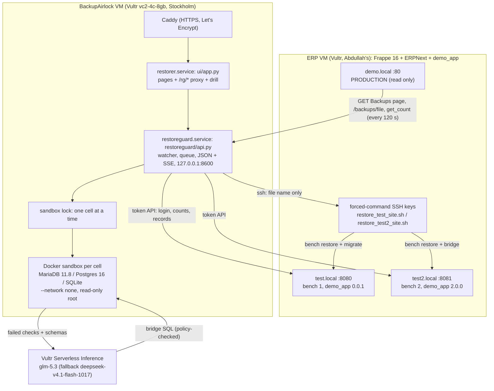

# Architecture

Two Vultr Cloud Compute VMs and Vultr Serverless Inference. Nothing runs outside Vultr.

## Components

| Unit | Code | Job |
|---|---|---|
| `restoreguard.service` | `restoreguard/api.py` | polls sources (local folder every 2 s, Frappe production every 120 s), queues one cell per backup x app version, streams events over SSE, keeps results in `state/` |
| one cell (Postgres) | `restoreguard/guard.py` | sha256 -> `pg_restore -f -` read + static scan -> restore in Postgres 16 sandbox -> `contract/manifest.sql` (9 counts + 3 sums) -> `contract/rules.sql` -> boot the app image in the sandbox's netns, probe `/health`, `/api/dashboard`, login -> on mismatch GLM bridge, up to 3 rounds |
| one cell (Frappe) | `restoreguard/frappe_target.py` | sha256 + gzip + static scan -> full site restore in MariaDB 11.8 sandbox -> counts for 135 doctypes vs production -> Demo Service Request rules from the dump's DocField -> `bench restore` of the test site over SSH -> live checks on the test site -> screenshot (`erp_shot.py`) |
| `restorer.service` | `ui/app.py`, `ui/static/` | the console; proxies the runtime; also runs the SQLite compatibility-matrix drill (`ui/sandbox.py`, `ui/verify.py`, `ui/apps/`) |
| Caddy | written by `install.sh` | TLS; SSE paths are not gzipped (gzip would buffer the live stream) |

## Heal (schema drift)

1. The cell finds the test site's app has another schema than the backup (Frappe: the test site's DocType API; Postgres: the app refuses to boot or the contract fails after its own migrations).
2. Frappe: the native restore runs once on the VM, so the certificate shows what `bench migrate` alone left (on demo_app 2.0.0: `effort_hours` = default 1, `category` empty).
3. GLM-5.3 gets old and new schema, sample rows and the failed checks, and writes SQL.
4. Policy check (`check_bridge`): only `UPDATE` of that doctype's table; no SELECT/JOIN/file/GRANT/shell escapes.
5. The bridge runs in a fresh sandbox against an emulation of `bench migrate`; proof is data (`carried`: every dropped field's values appear row for row in one new field) plus the app's rules. Failures go back to the model, up to 3 rounds.
6. Only then the VM restores again with the bridge on stdin; the test site is checked live. Verdict `healed`, bridge SQL downloadable.

## Results and the UI

`GET /api/backups` lists every backup with its cells, `GET /api/stream` is the SSE feed (step, log, check, bridge, verdict events), `GET /api/backups/{id}/certificate.json` the DR Readiness Certificate, `POST /api/runs` starts a scenario (fault copies are re-signed so the deeper checks get exercised). Full API: [../ui/README.md](../ui/README.md) "Runtime API"; runtime internals: [../restoreguard/README.md](../restoreguard/README.md).
